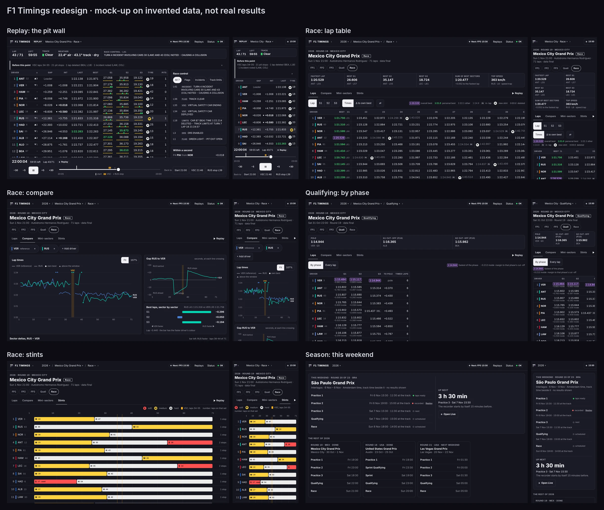

# F1 Timings redesign (design review, 7 November 2026)

Five independent critics, one discipline each (visual design, UX and information architecture, data visualisation, accessibility, and an F1 timing power user), reviewed [f1replay.app](https://f1replay.app/) and [f1hub.app](https://f1hub.app/) against the plan (A§1, A§13). This folder holds what they found, ten proposals for F1 Timings, and a mock-up of the result on invented data.

**The interactive review, with Keep/Tweak/Drop voting and comments:** https://claude.ai/artifact/96WFVvKAJdPZtL8BsiJ4m8 (private to the owner until shared from its Share menu). It also holds the captures of both sites, which stay out of git.

Status: a proposal. Nothing in the app changes until the owner picks proposals; four of them change a rule of A§13 and are marked **owner's call**.



## How it was reviewed

- Both sites captured with Playwright in Chromium (1440 × 900 and an iPhone 13 profile) on 7 November 2026, every main view, plus axe-core 4.10.3, a text-size histogram and target sizes.
- Each critic read A§1 and A§13, `apps/web/src/styles.css` and the captures, without the others' conclusions. Where they disagreed, a measurement decided (colour pairs through the dataviz validator's CVD ΔE in OKLab, and WCAG contrast).
- "Today" is the real web app, run against a local stand-in API that served the same invented data (not committed, per CLAUDE.md).

| On load | f1replay.app | f1hub.app | F1 Timings |
|---|---|---|---|
| Requests | 131, to 17 hosts | 50, to 6 hosts | same origin only (CSP) |
| Transferred | 11.6 MB | 22.5 MB | about 120 kB gzipped, plus 173 kB of charts on Compare |
| Trackers | Google Analytics, Tag Manager, Amplitude session replay, Sentry | Cloudflare Insights, Google sign-in | none |
| Text under 11 px | 313 of 421 text nodes | no DOM text (canvas) | none in the proposal |
| Controls under 44 px | 55 of 56 | not measurable (canvas) | none (a rule since phase P1d) |

## f1replay.app

A React replay and live-timing app on OpenF1 data: tower, track map, tyre strategy, race-control log, schedule.

**Verdict:** The closest thing to a pit wall, undone by 10 px type, colours that mean three things, and jump buttons that reveal the future.

**Take**

- *F1 user.* After a seek it lists what you skipped: counts per kind (81 pit stops, 10 fastest laps, 1 investigation) and each event as a jump target.
- *Visual.* One label grammar: small upper-case labels over bold tabular values in a divided strip. That alone reads as a timing screen.
- *Data viz.* Tyre strategy on one lap axis, in classification order, stints split by gaps, compound letter and stint length inside the bar.
- *F1 user.* Race control is always visible: the latest message above every tab, plus a filterable log with counts per kind.
- *Access.* Cues beyond colour: position change as an arrow and a number, tyres as letters in rings, states as words (PIT, INFO, WARN).
- *UX and IA.* The schedule shows your time and the track time, and each session has Replay and Result actions.

**Avoid**

- *F1 user, high.* The "PIT ›", "FLAG ›" and "SC ›" buttons jump to the next event and grey out when there is none, so an enabled "SC ›" tells you a safety car is coming.
- *Access, high.* 313 of 421 text nodes are under 11 px, 55 of 56 controls are under 44 px (14 under 24 px), and the purple best lap is 3.2:1. axe-core flags 13 contrast failures.
- *Data viz, high.* One hue means several things: green is a personal best, places gained and throttle; yellow is "other", places lost and medium tyres. All 63 sector bars in one capture are yellow, the loudest mark saying nothing.
- *Data viz, medium.* A 22-line position chart of a practice session, in about 11 hues, with smoothed curves that invent positions between laps.
- *UX and IA, medium.* Modals in the flow: an intro modal over the landing page, and the catch-up modal over the tower right after a seek.
- *Privacy, medium.* 131 requests to 17 hosts on load, 11.6 MB, including Google Analytics, Tag Manager, Amplitude with session replay, Sentry and a floating coffee button over the speed controls.

## f1hub.app

A Flutter web app (CanvasKit): circuits, calendar, driver and team standings, a prediction game and a weekend hub.

**Verdict:** A polished season magazine with little timing in it, painted on a canvas that assistive technology cannot read.

**Take**

- *Data viz.* Stat tiles: the value first, its label and unit beneath, four per row on a desktop and three on a phone.
- *UX and IA.* The calendar shows the season's state before you click: "18/24 races" progress and a status pill per round.
- *F1 user.* Race-control filters by scope (driver, sector, track, VSC) and by kind (alerts, stewards, penalties), with "10 of 169 messages".
- *Visual.* Team identity as a thin stripe beside neutral text, so the name stays readable whatever the team colour.

**Avoid**

- *Access, high.* The UI is painted on a canvas: the page has no DOM text. Find in page, text zoom and screen readers get nothing until a hidden "Enable accessibility" button is pressed, and then one label repeats the whole page.
- *UX and IA, high.* Slow looks the same as broken: the Circuits page still showed skeletons after 9 seconds, with no message.
- *F1 user, high.* Two pages give different season points for the same drivers (100, 80, 59 against 68, 55, 42) with no date or scope that explains it.
- *Data viz, medium.* Numbers without units or scale ("Temperature 16", "Tyre stress: 3") and sector lengths listed S1, S3, S2.
- *UX and IA, medium.* Two clocks: the playback slider says 03:05 while the log beside it already lists messages up to 03:30. "Back to Circuits" shows while Calendar is highlighted.
- *Privacy, medium.* 22.5 MB on load: the CanvasKit engine, Google Fonts and a Google sign-in script.

## F1 Timings today

**Keep**

- Honest gaps: a missing value is "—" with its reason one tap away.
- Real tables, sticky headers, 44 px targets, and a strict CSP with no third-party request at all (about 120 kB gzipped for the first view).
- Colour is never the only cue in the lap table: the purple best is boxed and the green best is bold.

**Fix**

- / lands on the latest lap table in result order, so the winner is row 1 before you have watched a delayed replay. ([capture](today/now-laps-desktop.webp))
- The lap table is a field of yellow (#ffd23f), brighter than the green and purple bests it should point you to. ([capture](today/now-laps-desktop.webp))
- In the light theme, personal-best green #18803a and "other" yellow #8a6400 are ΔE 4.6 apart for deuteranopes and 13.8 for full colour vision (the floors are 6 and 15). ([capture](today/now-laps-desktop-light.webp))
- Qualifying shows no phases, cut-offs or knock-outs: out- and in-laps fill most of the table. ([capture](today/now-quali-laps-desktop.webp))
- The player spreads seven buttons across the full width, and "+5 s" means later in a replay but more delay (earlier) when live. ([capture](today/now-replay-desktop.webp))
- On a phone, 22 driver chips push the Compare chart below the fold, and the reference driver is "the first one you picked". ([capture](today/now-compare-phone.webp))
- The deleted-lap hollow point can disappear at phone width: ECharts thins symbols when showAllSymbol is left at "auto" (found by the data-viz critic with a server-side render).

## Ten proposals

Numbered R1 to R10 (R for redesign; P numbers are phases here). Ranked by how many critics reached them and how much they change. Vote on them in the [interactive review](https://claude.ai/artifact/96WFVvKAJdPZtL8BsiJ4m8).

### R1. Spoiler-safe by default

*From: UX and IA, F1 user.*

- / opens the season page with "This weekend" first (or /live while a recording is open), never a table in result order.
- In a replay the player only jumps back: "Back to Start 21:00", "Back to VSC 21:46". Seek-bar markers show only what has happened up to now.
- After a seek, one dismissible line lists what you skipped ("Before this point: VSC laps 34–35, 21 pit stops, 1 lap deleted"), never a modal.

**Plan:** Changes the A§13 rule for /. Keeps the existing rule that the stream never sends anything ahead of T. **Owner's call.**

Mock-up: [desktop](renders/season-desktop-dark.webp) · [phone](renders/season-phone-dark.webp) · [light](renders/season-desktop-light.webp)

### R2. The pit wall for live and replay

*From: UX and IA, F1 user, Visual.*

- A status strip above the tower: lap, time left, track status, weather and the latest race-control message.
- A race-control panel with filters, a "within a second" list from the intervals, and the fastest lap so far.
- One control model around the session time T: every nudge moves T, so −5 is always earlier (live: 5 s more delay). The clock line sits in the player.
- A compact transport (−30, −5, Play, +5, +30) instead of seven stretched buttons.

**Plan:** Within A§11 and A§13. The nudge meaning changes in live mode.

Mock-up: [desktop](renders/replay-desktop-dark.webp) · [phone](renders/replay-phone-dark.webp) · [light](renders/replay-desktop-light.webp)

### R3. Qualifying by phase, and session tiles

*From: F1 user, Data viz.*

- Q1, Q2 and Q3 as columns from the server's quali_phase, each driver's best per phase, the margin to that phase's cut-off, and labelled knock-out lines.
- A tile row per session: fastest lap, best S1–S3, sum of best sectors (never "ideal lap"), top speed, each with its holder and lap.
- Live practice and qualifying need their own gap fields: the tower reads only the race keys today (to check against a recording).

**Plan:** Uses data the API already returns. The tile row is new to A§13.

Mock-up: [desktop](renders/quali-desktop-dark.webp) · [phone](renders/quali-phone-dark.webp) · [light](renders/quali-desktop-light.webp)

### R4. A lap table that points at the bests

*From: Visual, Data viz, Access.*

- "Other" times in plain text. Purple stays boxed and tinted, green stays bold. Measured: plain text is ΔE 19.8 from green for protanopes; the quiet-yellow alternative only 4.1.
- In- and out-laps dimmed with IN; the compound chip and a rule mark each new stint; VSC laps banded in the header.
- The driver and their best lap stay frozen while the laps scroll.
- A "Δ to own best" view: +0.41 per lap with a one-hue step behind it, so tyre fade shows as a gradient.

**Plan:** Changes the A§13 rule that "other" is yellow text. Mini-sectors keep yellow, as a shape (R5). **Owner's call.**

Mock-up: [desktop](renders/laps-desktop-dark.webp) · [phone](renders/laps-phone-dark.webp) · [light](renders/laps-desktop-light.webp)

### R5. Shapes, not only hues

*From: Access, Data viz.*

- Mini-sectors: "other" half height, personal best full, overall best full with a ring, pit lane hatched, no data dashed. The tower gets the legend it lacks.
- Seek-bar markers by shape: a tall tick for the start, a striped band for a VSC or red flag, a short tick for a pit stop.
- Light theme: green #0f7553, and team colours darkened to at least 3:1 on white (Mercedes #00D7B6 is 1.84:1 today).
- Forced-colours rules, focusable scroll regions, and screen-reader words for every colour cue (", personal best").

**Plan:** Within A§13; contrast.test.ts gains the --raised surface and the team-colour clamp.

Mock-up: [desktop](renders/replay-desktop-dark.webp) · [phone](renders/replay-phone-dark.webp) · [light](renders/replay-desktop-light.webp)

### R6. Compare that explains the race

*From: Data viz, UX and IA, F1 user.*

- Picked drivers as chips with the reference named, plus "Add driver", instead of 22 chips above the chart.
- A "Fit" window (fastest −1 s to +3 s) next to the 107 % window. Laps above it are triangles on the top edge, so none vanishes. Each driver's best is a ringed dot.
- A gap chart from the laps' own line crossings, the VSC as a band, a best-lap duel per sector, and a small bar in each delta cell.
- In the real chart: showAllSymbol true, so a deleted lap's hollow point never disappears.

**Plan:** Within A§13 apart from the default window (owner's call). **Owner's call.**

Mock-up: [desktop](renders/compare-desktop-dark.webp) · [phone](renders/compare-phone-dark.webp) · [light](renders/compare-desktop-light.webp)

### R7. Wayfinding

*From: UX and IA, Access.*

- A breadcrumb switcher (2026 / Mexico City Grand Prix / Race) with previous and next session.
- The weekend's sessions as pills under the title (FP1 … Race) that keep the current tab, and a Replay link when a recording exists.
- Replays in the header, a page title per route, and year links instead of a select that navigates on every arrow key.

**Plan:** Within A§13; needs a /replay list route.

Mock-up: [desktop](renders/laps-desktop-dark.webp) · [phone](renders/laps-phone-dark.webp) · [light](renders/laps-desktop-light.webp)

### R8. Stints on a real lap scale

*From: Data viz, F1 user.*

- Ticks every 10 laps with hairlines through the rows, the VSC as dashed lines, and a track to each driver's last lap so missing data shows.
- Labels hidden by a container query instead of clipped; used sets marked; stops counted; each row a button that reads out its stints.

**Plan:** Within A§13.

Mock-up: [desktop](renders/stints-desktop-dark.webp) · [phone](renders/stints-phone-dark.webp) · [light](renders/stints-desktop-light.webp)

### R9. Type and colour system

*From: Visual, Access.*

- One label grammar (12 px bold, upper case, tracked). Tables 14 px, tower 15 px, titles 26 px. Nothing under 11 px.
- A display face from fonts already on the device (DIN Alternate on Apple, Bahnschrift on Windows) for titles and the clock: no font file, no CSP change.
- Colour is data: no brand accent. Purple and green mean bests, red means live, a red flag or a failure.

**Plan:** Within A§13 ("No font or icon files").

Mock-up: [desktop](renders/laps-desktop-dark.webp) · [phone](renders/laps-phone-dark.webp) · [light](renders/laps-desktop-light.webp)

### R10. State that survives a reload

*From: UX and IA.*

- Keep the replay position and the picks in the URL: /replay/7?t=21:44:05, ?d=3,63, so a reload or a discarded phone tab comes back where you were, paused.

**Plan:** Changes A§13: the owner chose component state, not URL state. **Owner's call.**

Mock-up: [desktop](renders/replay-desktop-dark.webp) · [phone](renders/replay-phone-dark.webp) · [light](renders/replay-desktop-light.webp)

## Considered and rejected

- **Quiet-yellow "other" text (the visual critic's #cbbd8a).** It sits ΔE 4.1 from personal-best green for protanopes in the dark theme and 2.4 for deuteranopes in light.
- **Forward event jumps ("next SC").** Their enabled state reveals the future.
- **A fitted tyre-degradation slope.** "+0.083 s/lap" from eight laps is false precision, and the plan says nothing is interpolated.
- **Track map, telemetry traces, standings.** Non-goals in A§1.
- **A canvas-rendered UI.** No DOM text means no find, zoom or screen reader.

## Found in passing (separate fixes, not design)

1. **Compare chart: a deleted lap can lose its hollow point.** `apps/web/src/views/lap-chart-option.ts` sets `symbol: 'emptyCircle'` per deleted lap but leaves `showAllSymbol` at ECharts 6.1's default `'auto'`, which thins symbols that would overlap (the data-viz critic's server-side render kept every fourth symbol at 390 px for a 57-lap race). Fix: `showAllSymbol: true` with `symbol: 'none'` on ordinary laps. Also, ECharts' default `symbolSize` is 6 (`LineSeries.js`), so A§13's "8 px, twice the default" is off.
2. **Live tower outside races [U].** `apps/web/src/views/Tower.tsx` reads only `GapToLeader` and `IntervalToPositionAhead`. In practice and qualifying the feed reportedly sends `TimeDiffToFastest` and `TimeDiffToPositionAhead` (qualifying per part, under `Stats`), which `packages/contracts/src/live.ts` does not type, so Gap and Int may stay blank there. Check against a practice and a qualifying recording in `fixtures-private/`.
3. **Contrast test gap.** `apps/web/test/contrast.test.ts` checks text on `--bg` only; the light theme's green `#18803a` is 4.49:1 on `--raised`.

## The mock-up

Static HTML on invented data: 22 drivers on a 2026-like grid, a 71-lap race with a VSC on laps 34 and 35 and one retirement, a qualifying session, and a feed snapshot at lap 43, coloured by the A§9 rules. It follows the app's rules (tokens on one root, data only through `--team`, `--x` and `--w`, system fonts, no external requests), so its CSS can move into `apps/web/src/styles.css` piece by piece. Renders use the machine's system font (Inter here; SF Pro on macOS, Segoe UI on Windows).

| Screen | Desktop | Phone |
|---|---|---|
| replay | [dark](renders/replay-desktop-dark.webp) · [light](renders/replay-desktop-light.webp) | [dark](renders/replay-phone-dark.webp) · [light](renders/replay-phone-light.webp) |
| laps | [dark](renders/laps-desktop-dark.webp) · [light](renders/laps-desktop-light.webp) | [dark](renders/laps-phone-dark.webp) · [light](renders/laps-phone-light.webp) |
| compare | [dark](renders/compare-desktop-dark.webp) · [light](renders/compare-desktop-light.webp) | [dark](renders/compare-phone-dark.webp) · [light](renders/compare-phone-light.webp) |
| quali | [dark](renders/quali-desktop-dark.webp) · [light](renders/quali-desktop-light.webp) | [dark](renders/quali-phone-dark.webp) · [light](renders/quali-phone-light.webp) |
| stints | [dark](renders/stints-desktop-dark.webp) · [light](renders/stints-desktop-light.webp) | [dark](renders/stints-phone-dark.webp) · [light](renders/stints-phone-light.webp) |
| season | [dark](renders/season-desktop-dark.webp) · [light](renders/season-desktop-light.webp) | [dark](renders/season-phone-dark.webp) · [light](renders/season-phone-light.webp) |
| laps, Δ to own best | [dark](renders/laps-desktop-dark-delta.webp) | [dark](renders/laps-phone-dark-delta.webp) |

Regenerate (Node 26; `render.cjs` needs Playwright with Chromium, preinstalled in Claude Code cloud sessions and not a dependency of this repository):

```bash
cd docs/design/2026-11-redesign/mockup
```

```bash
node data.mjs && node preview.mjs
```

```bash
node render.cjs "$PWD/out/preview.html" out dark "" 2
```

- `synth.mjs`: the invented data and the tower's feed state at any time T.
- `data.mjs`: writes `out/data.json` (gitignored).
- `screens.mjs`: the six screens as markup, each for a 1280 px or a 390 px frame.
- `app.css`: the proposed tokens and components, scoped under `.app` and sized by container queries.
- `preview.mjs` and `render.cjs`: every frame on one page, then a screenshot per frame.

